```{=typst}
#set text(size: 10pt)
```

```{=typst}
#set align(center)
#v(1.5cm)
```

# Evaluating and Improving Cross-Dataset Generalization of Machine-Learning-Based Intrusion Detection Systems

```{=typst}
#v(0.9cm)
```

{width=2.4cm}\ 

**B.Tech. Project – I (End-Semester Report)**

**Department of Information Technology**

**Netaji Subhas University of Technology (NSUT), Dwarka, New Delhi**

```{=typst}
#v(0.9cm)
```

**Under the supervision of**

**Dr. Preeti Bansal**

```{=typst}
#v(0.9cm)
```

**Submitted by**

| Roll Number | Name |
|---|---|
| 2023UIN3323 | Shivam Chauhan |
| 2023UIN3330 | Shantanu Agarwal |
| 2023UIN3358 | Deepesh |

```{=typst}
#v(0.9cm)
```

**Date of submission:** November 2026

```{=typst}
#v(0.9cm)
```

*Supervisor's signature: __________________________*

```{=typst}
#set align(left)
#pagebreak()
```

## Table of Contents

| S.No. | Section |
|---|---|
| 1 | Abstract |
| 2 | Introduction |
| 3 | Motivation |
| 4 | Literature Survey |
| 5 | Problem Statement |
| 6 | Objectives |
| 7 | What Changed Since the Mid-Semester Evaluation |
| 8 | Proposed Methodology |
| 9 | Implementation |
| 10 | Results and Discussion |
| 11 | Limitations |
| 12 | Conclusion and Future Work |
| 13 | References |
| A | Appendix: Reproducing the Results |

```{=typst}
#pagebreak()
```

## 1. Abstract

Machine-learning intrusion detectors that score above 99% on the dataset they are trained on
are known to fail on other networks. This project measures that failure on CIC-IDS-2017,
UNSW-NB15 and TON_IoT, explains it, and proposes a method that avoids it.

Thirteen supervised models reach about 0.995 ROC AUC under 5-fold cross-validation within a
dataset and 0.42–0.49 when tested on a different dataset; six alignment and domain-adaptation
baselines do not change this. We trace the failure to the data: 11 of 30 harmonised features
reverse their relationship with the attack label between datasets, benign traffic of different
datasets remains perfectly separable after alignment, and even the same attack family rarely
transfers. We also audit our own mid-semester result: an exhaustive evaluation of all 4,095
feature subsets shows that the reported gain of metaheuristic feature selection came from
choosing the subset on the test pairs, and that no subset chosen without the target dataset
improves supervised transfer.

We then propose **BRACE**, which does not transfer a classifier. It is set up on the target
network from a sample of its benign traffic and its unlabelled stream, using a benign-anchored
representation, a nearest-neighbour distance score, a benign-versus-unlabelled classifier, and a
calibrated fusion of the two. A genetic algorithm selects features with a **fitness that needs
no attack label**: the alarm rate on the unlabelled stream at a threshold fixed from benign
flows, which is a monotone function of the true detection rate. Without any attack label or
source data, BRACE reaches 0.980 / 0.972 / 0.998 AUC on the three datasets and 0.968 on
CSE-CIC-IDS2018, which was held out until the method was frozen; a supervised model given the
target's labels reaches 0.998 / 0.985 / 1.000 and 0.981, and the best supervised transfer 0.870 /
0.721 / 0.846. Label-free GA selection raises the detection rate of the distance score at 1%
false alarms from 0.30 / 0.49 / 0.67 to 0.53 / 0.71 / 0.79.

The limits are reported alongside: the fusion gives no benefit when the stream contains very few
attacks, web and botnet attacks are mostly missed, the GA adds little inside the fused detector,
and when the benign calibration traffic comes from a different day than the monitored traffic
the false-alarm rate rises well above its target.

**Keywords:** network intrusion detection, cross-dataset generalisation, dataset shift,
metaheuristic feature selection, genetic algorithm, semi-supervised novelty detection,
conformal calibration.

```{=typst}
#pagebreak()
```

## 2. Introduction

A network intrusion detection system (NIDS) inspects traffic and raises an alarm when a flow looks
malicious. Machine-learning NIDS are trained on labelled benchmark datasets and routinely report
accuracies above 99% [1], [5]–[7]. Those figures are obtained by training and testing on random
splits of the *same* capture. A deployed detector faces a different situation: it is trained on one
network and must work on another, with different hosts, services, traffic mix and attack tools.

This project studies that situation directly. We train on one public dataset and test on another,
across CIC-IDS-2017 [5], UNSW-NB15 [6] and TON_IoT [7], and ask two questions:

1. How much of the reported performance survives the move to a different dataset, and why does
   the rest disappear?
2. What can be done about it, and where does metaheuristic feature selection help?

The mid-semester work answered the first question for five tree ensembles and proposed
*Domain-Aligned Metaheuristic Feature Selection* (DA-MFS) for the second. In this half of the
project we rebuilt the experimental pipeline, found that the mid-semester DA-MFS result did not
survive a leak-free evaluation, diagnosed why supervised transfer fails on these datasets, and
developed a different method that works without transferring a classifier at all. The result is
**BRACE** (*Benign-Relative Anomaly scoring with Calibrated Evolutionary selection*): a detector
that is set up on the target network from a sample of its own benign traffic and its own
unlabelled stream, with a genetic algorithm choosing features by a fitness that needs no attack
label.

The contributions of this report are:

- **A leak-free cross-dataset benchmark** of 13 supervised models and 6 alignment or
  domain-adaptation baselines on 30 harmonised features, with proper same-dataset
  cross-validation as the reference (Section 10.1).
- **A diagnosis of the failure.** We show that 11 of the 30 shared features point in *opposite
  directions* in different datasets, that benign traffic of two datasets remains perfectly
  separable after alignment, and that even the same attack family rarely transfers (Section 10.2).
- **An audit of our own mid-semester result.** By evaluating all 4,095 subsets exhaustively we
  show that the gain reported at mid-semester came from choosing the subset on the test pairs,
  and that no subset chosen without the target dataset beats using all features (Section 10.3).
- **BRACE**, a target-side method that uses no source data and no attack label, and a
  **label-free fitness function** that lets GA, PSO, DE and other metaheuristics select features
  on the deployment network itself (Sections 8, 10.4–10.8).
- **Validation on a fourth dataset** (CSE-CIC-IDS2018) that was not used while the method was
  designed, and on a temporal protocol where the calibration traffic comes from a different day
  than the traffic being monitored (Section 10.9).

## 3. Motivation

**The headline numbers do not describe deployment.** Cantone et al. [1] trained standard models on
one dataset and tested them on others, and found performance close to chance. Later studies report
the same on newer datasets and models [2]–[4], [23], [24]. Our own benchmark agrees: every
supervised model we tried scores about 0.995 AUC on the dataset it was trained on and between 0.42
and 0.49 on a different one (Section 10.1).

**Labelled attacks on the target network are the one thing an operator does not have.** If
labelled attacks from the deployment network were available, an ordinary supervised model would
do well; we measure this as an upper reference. What an operator does have is (i) traffic recorded
while the network was believed to be clean, and (ii) an endless unlabelled stream of live traffic.
A method that uses only these two resources can be deployed anywhere.

**Feature selection for NIDS is evaluated in the wrong setting.** The metaheuristic feature
selection literature optimises accuracy on a single dataset [8]–[12]. A subset chosen that way has
never been required to work on another network, and the fitness function needs attack labels,
which the target network does not provide. A fitness that can be computed on the target without
labels removes both problems.

**Evaluation mistakes are easy to make.** Arp et al. [34] list data snooping among the most common
pitfalls in security machine learning. We found one in our own mid-semester pipeline (Section 7).
Reporting it, and the corrected numbers, is part of the motivation for the stricter protocol used
here.

## 4. Literature Survey

### 4.1 Benchmark datasets

CIC-IDS-2017 [5] contains five days of traffic from a small enterprise testbed with brute-force,
DoS/DDoS, web, infiltration, botnet and port-scan attacks; flows are exported by CICFlowMeter.
UNSW-NB15 [6] was generated with the IXIA PerfectStorm tool and has nine attack categories
(fuzzers, analysis, backdoor, DoS, exploits, generic, reconnaissance, shellcode, worms); flows are
exported by Argus and Bro. TON_IoT [7] comes from an IoT/IIoT testbed with nine attack types
(including ransomware, injection, XSS and man-in-the-middle); flows are Zeek connection records.
CSE-CIC-IDS2018 [29] repeats the CIC-IDS-2017 design on a larger AWS-hosted topology. Ring et
al. [14] survey these and other datasets. Engelen et al. [33] document labelling and flow-export
errors in CIC-IDS-2017; we met one of them ourselves (TCP flag counters, Section 7).

### 4.2 Cross-dataset generalisation

Cantone et al. [1] is the reference study: models that exceed 0.99 within a dataset fall to
near-chance across datasets. Apruzzese et al. [23] formalise "cross-evaluation" and show both its
value and its risks. Layeghy and Portmann [24] explain the failure through the different feature
distributions of each dataset. Hossain et al. [2], Hakim et al. [3] and Butt et al. [4] extend the
finding to recent datasets, lightweight IIoT models and tabular deep-learning models. Golchin et
al. [22] train a self-supervised model on benign traffic only and report that, without fine-tuning
on labelled target samples, the average AUROC across datasets "resembles random guessing".

### 4.3 Domain adaptation for NIDS

DI-NIDS [13] learns domain-invariant features adversarially from several source datasets. CORAL
and Deep CORAL [28] align feature covariances, DANN [27] aligns distributions with a domain
discriminator, and KRDA [16] uses a transport map. All of these still transfer a decision boundary
learned on the source. Han et al. [25] address the drift of *normal* traffic over time on one
network. We include CORAL, Deep CORAL, DANN and three per-dataset normalisations as baselines.

### 4.4 Metaheuristic feature selection for NIDS

Genetic algorithms, particle swarm optimisation, grey wolf and whale optimisers are widely used
to select NIDS features [8], [10], [11]; multi-objective variants trade accuracy against the
number of features [9], [12]. Suman et al. [9] use NSGA-II with unsupervised information-theoretic
objectives. In all of these the search and the evaluation happen inside one dataset. We found no
study in which a metaheuristic selects features on an unlabelled *target* network.

### 4.5 Learning from benign and unlabelled data

Blanchard et al. [17] show that a classifier trained to separate a clean sample of normal data
from an unlabelled mixture of normal and novel data ranks points in the same order as a detector
trained with labels ("semi-supervised novelty detection"). Elkan and Noto [18] give the related
positive-unlabelled result. Bates et al. [19] turn the scores of any detector into conformal
p-values with a guaranteed false-alarm rate, using a held-out clean sample, and Marandon et
al. [20] combine the two ideas with false-discovery-rate control. Siddiquee et al. [21] use the
AUC between a clean set and an unlabelled set to select models in medical imaging. Dilworth and
Gudla [26] survey positive-unlabelled learning in security, where it is normally applied with
*known attacks* as the labelled class. We apply these ideas in the opposite direction (benign is
the labelled class), to the cross-dataset NIDS problem, and extend the label-free criterion to a
tail-weighted form that a metaheuristic can optimise.

### 4.6 Gap

| Line of work | Needs target attack labels | Needs source data | Selects features on the target |
|---|---|---|---|
| Supervised cross-dataset studies [1]–[4] | no | yes | no |
| Domain adaptation [13], [16], [27], [28] | no | yes | no |
| Metaheuristic feature selection [8]–[12] | yes (same dataset) | – | – |
| Self-supervised benign pre-training [22] | yes, for fine-tuning | yes | no |
| **This work (BRACE)** | **no** | **no** | **yes, label-free** |

## 5. Problem Statement

Given a target network for which only (a) a sample of benign flows and (b) an unlabelled stream of
live flows are available, build a flow-level detector that separates attacks from benign traffic
with a controlled false-alarm rate, without any labelled attack from the target and without
assuming that a classifier trained on another dataset transfers. Quantify how far existing
supervised, domain-adaptation and feature-selection approaches fall short in the same setting,
and explain why.

## 6. Objectives

1. Harmonise CIC-IDS-2017, UNSW-NB15 and TON_IoT (and CSE-CIC-IDS2018 for external validation)
   into one feature space with consistent definitions.
2. Benchmark supervised models, alignment methods and domain-adaptation methods under a
   leak-free protocol, with proper same-dataset cross-validation as reference.
3. Diagnose the cause of cross-dataset failure at the level of features, benign traffic and
   attack families.
4. Re-examine the mid-semester DA-MFS method under a leak-free protocol.
5. Design a target-side method that needs no attack labels, with metaheuristic feature selection
   driven by a label-free fitness.
6. Evaluate it against attack prevalence, calibration size, a temporal protocol and an unseen
   dataset; compare optimisers; report per-attack-family behaviour and limitations.

## 7. What Changed Since the Mid-Semester Evaluation

Before extending the mid-semester pipeline we re-read its code line by line. Seven problems were
found and corrected. We list them because they change the mid-semester conclusions.

| # | Problem in the mid-semester pipeline | Consequence | Correction |
|---|---|---|---|
| 1 | The GA/PSO fitness scored each feature subset on the same six train→test pairs that were then reported. | The reported gain of DA-MFS was selected on the test labels. | Selection never sees the target dataset (Section 10.3). |
| 2 | "Same-dataset" scores were computed on the training rows. | The in-dataset reference was inflated. | Stratified 5-fold cross-validation. |
| 3 | Only 12 features derived from 5 counters were searched (4,095 subsets). | A metaheuristic is unnecessary at that size; exhaustive search is exact. | 30-feature pool (about 10^9 subsets) for the optimisers; the 12-feature space is enumerated exhaustively for the audit. |
| 4 | Mean cross-dataset accuracy (0.508) was below the majority-class rate. | Accuracy hid that the models were not better than a constant guess. | AUC, balanced accuracy, and detection rate at a fixed false-alarm rate. |
| 5 | Byte counts mixed payload bytes (CIC, TON) with header-inclusive bytes (UNSW). | An artificial shift between datasets. | All datasets use header-inclusive wire bytes. |
| 6 | CIC-IDS-2017 TCP flag counters are unreliable (SYN count is zero for about 94% of TCP flows). | Connection-state features could not be harmonised. | Dropped; a "no reply" flag from packet counts is used instead. |
| 7 | The text described models and libraries that the code did not use. | Report and code disagreed. | This report describes only what `src/xids/` runs. |

## 8. Proposed Methodology

### 8.1 Harmonised feature space

Every dataset is reduced to a base table with duration, packets and bytes in each direction,
transport protocol, a coarse service class and the label. From it, 30 features in seven families
are derived (Table 1). Nothing dataset-specific survives harmonisation.

**Table 1. The 30-feature pool.**

| Family | Features |
|---|---|
| Volume (7) | duration, src/dst packets, src/dst bytes, total packets, total bytes |
| Packet size (4) | bytes per packet (src, dst, both), packet-size asymmetry |
| Direction ratio (2) | packet ratio, byte ratio |
| Rate (7) | packets/s and bytes/s (total, src, dst), mean inter-arrival time |
| Shape (1) | no reply (zero packets from the destination) |
| Protocol (2) | is TCP, is UDP |
| Service (7) | DNS, HTTP, SSL, SSH, FTP, mail, other |

### 8.2 Protocols

*Supervised transfer.* **Same**: stratified 5-fold cross-validation inside one dataset.
**Pair**: train on one dataset, test on another (six pairs). **LODO**: train on two datasets,
test on the third. Every split is repeated with three seeds on class-stratified samples.

*Target-side deployment.* For a target dataset, three disjoint parts are drawn:

- **calibration**: benign flows only ("traffic recorded while the network was known to be
  clean"), further split 40/30/30 into a reference set, a selection set and a threshold set;
- **unlabelled stream**: 30,000 flows whose labels are hidden from the method, with the attack
  share set to the dataset's natural value, 10%, 2% or 0.5%;
- **test stream**: disjoint from both, used only to compute the reported numbers.

No source dataset is used. In the **temporal** variant the calibration flows come from one
capture day and the two streams from the other days.

### 8.3 BRACE

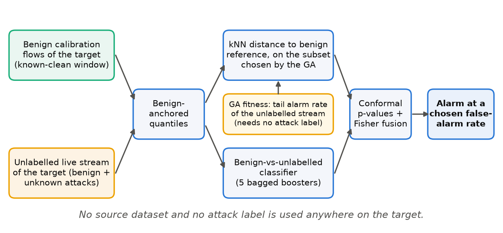{width=92%}

**Step 1, benign-anchored representation.** Each feature value is replaced by the normal score of
its rank among the benign reference flows of the *target*. After this step "0" means "typical for
this network" and a large absolute value means "rare for this network", whatever the raw unit.

**Step 2, benign-relative score (kNN).** The anomaly score of a flow is its mean distance to its
five nearest benign reference flows, on a subset $m$ of the features. This score needs only
benign calibration data and does not depend on how many attacks the stream contains.

**Step 3, label-free evolutionary feature selection.** Let the unlabelled stream contain an
unknown fraction $\pi$ of attacks. For a subset $m$, set the alarm threshold at the
$(1-\alpha)$ quantile of the scores of the benign *selection* set, and count the fraction of the
unlabelled stream that raises an alarm. In expectation

$$\text{alarm rate}(m,\alpha) \;=\; \pi \cdot \mathrm{TPR}_\alpha(m) \;+\; (1-\pi)\cdot\alpha .$$

Since $\pi$ and $\alpha$ do not depend on $m$, **the subset with the highest alarm rate is the
subset with the highest true detection rate**, and it can be found without a single attack label.
The same argument gives $\mathrm{AUC}(\text{unlabelled vs benign}) = 0.5 + \pi\,(\mathrm{AUC}_{true}-0.5)$ [17].
The fitness used by BRACE is the alarm rate averaged over ten thresholds with $\alpha$ between
0.5% and 5%, which concentrates the search on the low-false-alarm region an operator cares about.
A genetic algorithm (population 30, tournament selection, uniform crossover, bit-flip mutation at
rate 1/30, two elites, 300 fitness evaluations) maximises it. Eight other optimisers are compared
in Section 10.7.

**Step 4, benign-versus-unlabelled classifier.** Five small gradient-boosting models (100 trees,
7 leaves) are trained to separate benign calibration flows from the unlabelled stream, each
without one fifth of the data, and their outputs are averaged. Because the stream is a mixture of
benign flows and attacks, the best possible such classifier ranks flows by the attack-to-benign
likelihood ratio [17], which is what a supervised detector trained with labels would do. This
score can find attacks that sit *inside* the benign range of every single feature, which a
distance score cannot; in exchange it weakens when attacks are rare in the stream.

**Step 5, calibrated fusion.** Each score is converted to a conformal p-value against the benign
threshold set [19], and the two p-values are combined with Fisher's method,
$-\log p_{kNN} - \log p_{PU}$ [32]. The alarm threshold of the fused score is the
$(1-\alpha)$ quantile of the fused scores of the threshold set, so the false-alarm rate on benign
traffic of the same distribution is $\alpha$ by construction.

### 8.4 Baselines and references

- **Supervised transfer**: majority class, logistic regression, linear SVM, naive Bayes, decision
  tree, random forest, extra trees, histogram gradient boosting, XGBoost, LightGBM, k-nearest
  neighbours, MLP, FT-Transformer.
- **Alignment and domain adaptation**: per-dataset standardisation, per-dataset quantile
  alignment, benign-anchored quantiles, CORAL, Deep CORAL, DANN.
- **Feature selection for supervised transfer**: exhaustive search over the 12-feature space,
  mutual information, random-forest importance, L1 logistic regression, recursive feature
  elimination, correlation filter.
- **Benign-only detectors**: kNN (k = 1, 5, 10, 20), LOF, isolation forest, one-class SVM,
  Gaussian mixture, Mahalanobis distance, ECOD, HBOS, PCA reconstruction, autoencoder.
- **Upper reference**: LightGBM trained on the unlabelled stream *with its true labels*.

### 8.5 Metrics

ROC AUC (threshold-free and independent of class balance), detection rate (TPR) at 1% and 5%
false alarms with the threshold taken from held-out benign flows, the realised false-alarm rate,
balanced accuracy, macro-F1 and MCC. Plain accuracy is not used as a headline number because the
attack share differs from 20% to 76% between datasets.

## 9. Implementation

The project is implemented in Python 3.12 with NumPy, pandas, scikit-learn, LightGBM, XGBoost and
PyTorch. The kNN scorer runs on the GPU (RTX 4050, 6 GB), which is what makes thousands of fitness
evaluations affordable: one evaluation scores about 32,000 flows against 2,400 reference flows in
20–40 ms.

**Table 2. Harmonised datasets.**

| Dataset | Flows | Attack share | Attack types | TCP share | Flows with no reply |
|---|---|---|---|---|---|
| CIC-IDS-2017 | 2,830,743 | 19.7% | 14 | 64.6% | 16.0% |
| UNSW-NB15 | 257,673 | 63.9% | 9 | 47.8% | 46.7% |
| TON_IoT | 211,043 | 76.3% | 9 | 80.0% | 39.4% |
| CSE-CIC-IDS2018 (external) | 8,284,195 | 26.2% | – | – | – |

**Table 3. Code layout (`src/xids/`, `experiments/`).**

| Module | Role |
|---|---|
| `harmonise.py`, `features.py` | Loaders for the four datasets; the 30-feature pool |
| `anchor.py` | Benign-anchored quantile, robust-z and log-standard representations |
| `data.py`, `core.py` | Deployment split; target context; label-free fitness |
| `knn.py`, `detectors.py`, `pu.py` | GPU kNN scorer; 13 benign-only detectors; benign-vs-unlabelled classifier |
| `optimisers.py` | Random search, greedy forward selection, simulated annealing, GA, binary PSO, binary DE, grey wolf, whale, NSGA-II behind one interface |
| `models.py` | 13 supervised models, DANN, Deep CORAL |
| `experiments/01`–`11` | One script per experiment, each writing a CSV to `results/v2/` |

Development decisions (the classifier settings in Step 4 and the choice of fitness) were taken on
separate development seeds (≥ 100) and on the three main datasets. CSE-CIC-IDS2018 was downloaded
and harmonised early but no detection result on it was computed until the method was frozen.

## 10. Results and Discussion

### 10.1 Supervised models do not transfer

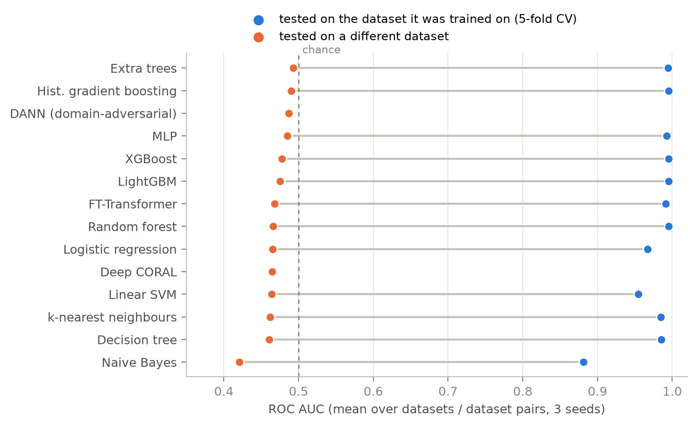{width=78%}

**Table 4. Supervised models on raw features (ROC AUC / balanced accuracy, mean of 3 seeds).**

| Model | Same dataset (5-fold CV) | One source → other dataset | Two sources → third dataset |
|---|---|---|---|
| Extra trees | 0.995 / 0.970 | 0.493 / 0.463 | 0.580 / 0.509 |
| Hist. gradient boosting | 0.995 / 0.970 | 0.490 / 0.470 | 0.586 / 0.507 |
| DANN | – | 0.487 / 0.475 | 0.593 / 0.531 |
| MLP | 0.993 / 0.962 | 0.485 / 0.468 | 0.611 / 0.520 |
| XGBoost | 0.995 / 0.971 | 0.478 / 0.477 | 0.567 / 0.518 |
| LightGBM | 0.995 / 0.971 | 0.475 / 0.464 | 0.553 / 0.507 |
| FT-Transformer | 0.991 / 0.959 | 0.468 / 0.496 | 0.480 / 0.522 |
| Random forest | 0.995 / 0.971 | 0.466 / 0.468 | 0.485 / 0.507 |
| Logistic regression | 0.967 / 0.913 | 0.465 / 0.457 | 0.546 / 0.561 |
| Deep CORAL | – | 0.465 / 0.459 | 0.570 / 0.537 |
| Linear SVM | 0.955 / 0.895 | 0.464 / 0.476 | 0.505 / 0.499 |
| k-nearest neighbours | 0.985 / 0.955 | 0.462 / 0.462 | 0.523 / 0.528 |
| Decision tree | 0.985 / 0.966 | 0.460 / 0.472 | 0.482 / 0.468 |
| Naive Bayes | 0.881 / 0.790 | 0.421 / 0.486 | 0.469 / 0.458 |

Inside a dataset the task is easy: nine of the twelve models reach 0.985 AUC or more. Across
datasets every model is at or *below* chance on average. The model family makes no difference:
the spread between the best and worst cross-dataset model (0.07 AUC) is far smaller than the gap
to the same-dataset number (0.5 AUC). Training on two datasets helps a little (best 0.611).

**Table 5. Alignment and domain adaptation, one source → one target (ROC AUC).**

| Representation | Logistic regression | Random forest | LightGBM | MLP |
|---|---|---|---|---|
| Raw | 0.465 | 0.466 | 0.475 | 0.485 |
| Per-dataset standardisation | 0.516 | 0.524 | 0.486 | 0.492 |
| Per-dataset quantile alignment | 0.443 | 0.535 | 0.515 | 0.501 |
| CORAL | 0.476 | 0.532 | 0.516 | 0.484 |
| Benign-anchored quantiles | 0.462 | 0.599 | 0.554 | 0.525 |

No alignment lifts the average above 0.60. The averages hide large differences between pairs
(LightGBM, raw: CIC-IDS-2017 → TON_IoT 0.906, but UNSW-NB15 → TON_IoT 0.151 and TON_IoT → UNSW-NB15
0.314). An AUC far below 0.5 means the model is confidently *wrong*: it ranks benign flows as
more suspicious than attacks. Section 10.2 explains why. If an oracle chose the best model,
alignment and protocol separately for each target, supervised transfer would reach 0.870
(CIC-IDS-2017), 0.721 (UNSW-NB15) and 0.846 (TON_IoT); the median configuration reaches 0.618,
0.383 and 0.510. We use the oracle figure as the "best supervised transfer" reference later.

### 10.2 Why transfer fails

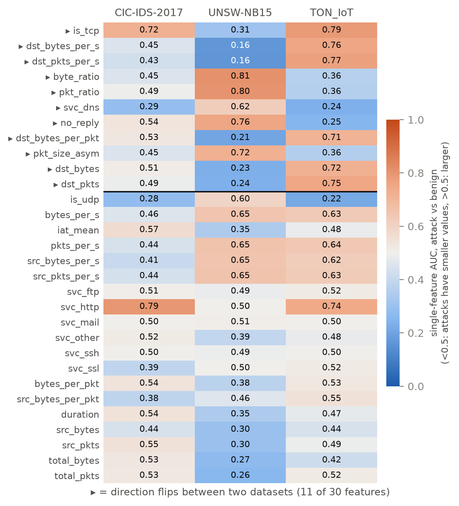{width=62%}

**The same feature means opposite things.** For each feature and dataset we computed the AUC of
the raw value for attack versus benign (Figure 3). Eleven of the 30 features flip direction
between two datasets with a strong effect on both sides. Response volume is the clearest case:
in UNSW-NB15 attacks receive *fewer* packets from the destination than benign flows (AUC 0.24),
in TON_IoT they receive *more* (0.75). A flow with no reply is suspicious in UNSW-NB15 (0.76)
and reassuring in TON_IoT (0.25). A model that learns "little response = attack" on UNSW-NB15
is therefore systematically wrong on TON_IoT, which is exactly the 0.151 observed above.

**Benign traffic of two networks does not overlap.** A classifier asked to tell which dataset a
*benign* flow comes from reaches AUC 1.000 for all three pairs on raw features, and still 1.000
after each dataset is anchored to its own benign quantiles. Marginal alignment cannot make two
networks look alike, because the difference is in the joint structure of the features.

**Even the same attack family rarely transfers.** We trained "benign versus one family" on one
dataset and tested on the same family in another (Table 6), which removes the mismatch of attack
catalogues.

**Table 6. Benign versus one attack family, trained on the row dataset and tested on the column
dataset (ROC AUC, benign-anchored features). Diagonal: 3-fold cross-validation.**

| Family | Trained on | CIC-IDS-2017 | UNSW-NB15 | TON_IoT |
|---|---|---|---|---|
| DoS | CIC-IDS-2017 | 1.000 | 0.468 | 0.545 |
| DoS | UNSW-NB15 | 0.729 | 0.998 | 0.095 |
| DoS | TON_IoT | 0.566 | 0.204 | 1.000 |
| Reconnaissance | CIC-IDS-2017 | 0.996 | 0.433 | 0.556 |
| Reconnaissance | UNSW-NB15 | 0.409 | 0.999 | 0.648 |
| Reconnaissance | TON_IoT | 0.844 | 0.410 | 1.000 |
| Brute force | CIC-IDS-2017 | 1.000 | – | 0.342 |
| Brute force | TON_IoT | 0.875 | – | 1.000 |
| Web | CIC-IDS-2017 | 0.998 | – | 0.953 |
| Web | TON_IoT | 0.932 | – | 1.000 |
| Backdoor | UNSW-NB15 | – | 1.000 | 0.400 |
| Backdoor | TON_IoT | – | 0.188 | 1.000 |

"DoS" in one testbed and "DoS" in another are different tools against different services and
leave different flow statistics. Only web attacks, which share the HTTP service signature,
transfer in both directions (0.93–0.95). The conclusion is that on these datasets *what an attack
looks like* is not a transferable concept at the level of flow statistics, whereas *what is
unusual for this network* can be defined on any network.

### 10.3 The mid-semester feature selection, re-examined

The mid-semester DA-MFS searched the 12-feature space with a GA and binary PSO, using mean
cross-dataset performance on the six pairs as fitness. That space has only 4,095 subsets, so we
trained a LightGBM model on every subset and every source and tested it on every target. With
the full table the questions have exact answers, with no optimiser in the loop.

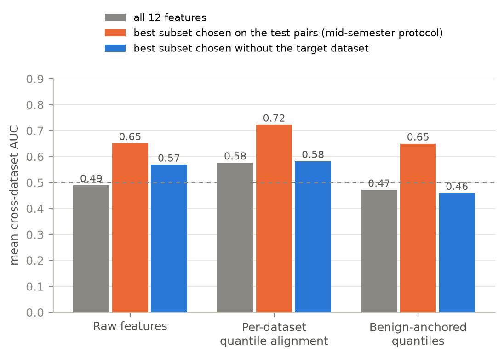{width=70%}

**Table 7. Supervised cross-dataset AUC over all 4,095 subsets.**

| Representation | All 12 features | Best subset, chosen on the test pairs | Best subset, chosen without the target | Median subset |
|---|---|---|---|---|
| Raw | 0.490 | 0.651 | 0.569 | 0.474 |
| Per-dataset quantile alignment | 0.576 | 0.723 | 0.582 | 0.564 |
| Benign-anchored quantiles | 0.471 | 0.650 | 0.460 | 0.475 |

Choosing the subset on the test pairs lifts AUC by 0.15–0.18. This is the upper bound for *any*
optimiser under the mid-semester protocol, and it is selection on the test labels. When the
subset for a target is instead chosen as the one that transfers best *between the other two
datasets*, the result is 0.46–0.58: no better than all features for two of the three
representations, and still close to chance. The subsets the oracle picks have only two or three
features. Standard source-side selection (mutual information, random-forest importance, L1,
RFE, correlation filter) gives 0.43–0.54 at every subset size.

**The mid-semester claim that DA-MFS improves cross-dataset generalisation is therefore
withdrawn.** The honest statement is that no feature subset we can identify without target
information makes a source-trained classifier transfer on these datasets.

### 10.4 BRACE: detection on the target without attack labels

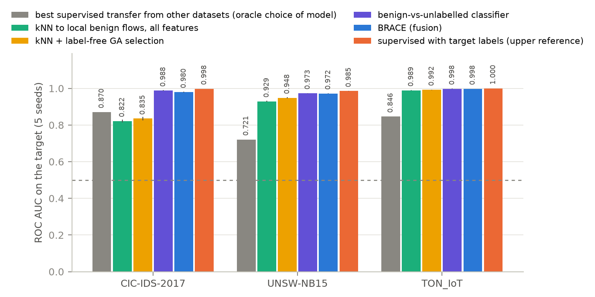{width=92%}

**Table 8. Target-side methods at the natural attack share of each dataset (mean ± standard
deviation over 5 seeds; 6,000 benign calibration flows).**

| Method | Uses | CIC-IDS-2017 AUC | UNSW-NB15 AUC | TON_IoT AUC | Detection at 1% false alarms (CIC / UNSW / TON) |
|---|---|---|---|---|---|
| Best supervised transfer (oracle) | other datasets' labels | 0.870 | 0.721 | 0.846 | – |
| kNN, all 30 features | benign | 0.822 ± 0.007 | 0.929 ± 0.003 | 0.989 ± 0.001 | 0.30 / 0.49 / 0.67 |
| kNN + GA selection | benign + unlabelled | 0.835 ± 0.009 | 0.948 ± 0.003 | 0.992 ± 0.001 | 0.53 / 0.71 / 0.79 |
| Benign-vs-unlabelled classifier | benign + unlabelled | 0.988 ± 0.003 | 0.973 ± 0.001 | 0.998 ± 0.000 | 0.82 / 0.77 / 0.98 |
| Fusion without GA (ablation) | benign + unlabelled | 0.980 ± 0.002 | 0.970 ± 0.001 | 0.997 ± 0.000 | 0.80 / 0.76 / 0.94 |
| **BRACE** | benign + unlabelled | **0.980 ± 0.002** | **0.972 ± 0.001** | **0.998 ± 0.000** | **0.80 / 0.78 / 0.96** |
| Supervised on target labels (upper reference) | target attack labels | 0.998 ± 0.000 | 0.985 ± 0.000 | 1.000 ± 0.000 | 0.93 / 0.85 / 1.00 |

Three observations.

1. **Not transferring a classifier beats every way of transferring one.** Even the simplest
   target-side detector (kNN to the network's own benign flows, with no source data) is far ahead
   of the best supervised transfer on UNSW-NB15 and TON_IoT, and BRACE is ahead on all three by
   0.11–0.25 AUC.
2. **BRACE comes within 0.02 AUC of a supervised model that has the target's labels**, while
   using none of them. At 1% false alarms it detects 80%, 78% and 96% of attacks, against 93%,
   85% and 100% for the labelled reference.
3. **At the natural attack share, the benign-vs-unlabelled classifier alone is as good as the
   fusion** (slightly better on CIC-IDS-2017). The reason for the fusion appears when attacks
   become rare (Section 10.5).

The false-alarm rate is controlled as designed: over all 120 runs of Section 10.5 the realised
rate of BRACE averages 1.1% at a 1% target and 5.1% at a 5% target (worst single run 2.0% and
6.7%).

### 10.5 How many attacks must the unlabelled stream contain?

The classifier of Step 4 learns from the attacks hidden in the unlabelled stream. Real traffic
contains far fewer attacks than the benchmark datasets, so we reduced the attack share of the
stream to 10%, 2% and 0.5% (3,000, 600 and 150 attacks among 30,000 flows).

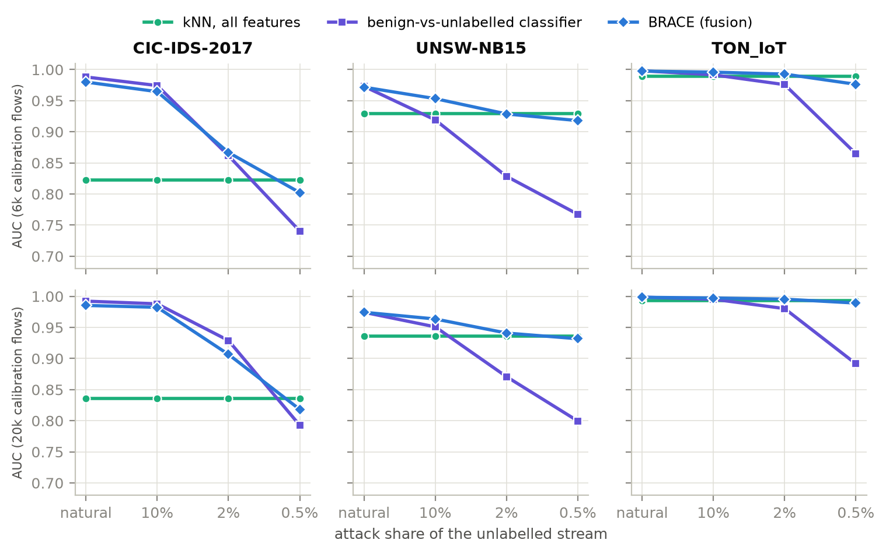{width=95%}

**Table 9. ROC AUC by attack share of the unlabelled stream (5 seeds).**

| Target | Attack share | kNN (6k) | Classifier (6k) | BRACE (6k) | kNN (20k) | Classifier (20k) | BRACE (20k) |
|---|---|---|---|---|---|---|---|
| CIC-IDS-2017 | natural (20%) | 0.822 | 0.988 | 0.980 | 0.836 | 0.992 | 0.985 |
| | 10% | 0.822 | 0.974 | 0.965 | 0.836 | 0.988 | 0.982 |
| | 2% | 0.822 | 0.862 | 0.867 | 0.836 | 0.929 | 0.907 |
| | 0.5% | 0.822 | 0.740 | 0.802 | 0.836 | 0.793 | 0.818 |
| UNSW-NB15 | natural (64%) | 0.929 | 0.973 | 0.972 | 0.936 | 0.974 | 0.974 |
| | 10% | 0.929 | 0.919 | 0.953 | 0.936 | 0.951 | 0.964 |
| | 2% | 0.929 | 0.828 | 0.929 | 0.936 | 0.871 | 0.941 |
| | 0.5% | 0.929 | 0.768 | 0.918 | 0.936 | 0.800 | 0.932 |
| TON_IoT | natural (76%) | 0.989 | 0.998 | 0.998 | 0.993 | 0.999 | 0.998 |
| | 10% | 0.989 | 0.992 | 0.996 | 0.993 | 0.995 | 0.997 |
| | 2% | 0.989 | 0.976 | 0.993 | 0.993 | 0.980 | 0.995 |
| | 0.5% | 0.989 | 0.865 | 0.976 | 0.993 | 0.892 | 0.989 |

- The classifier alone is the best method when attacks are plentiful and the worst when they are
  rare: on UNSW-NB15 it falls from 0.973 to 0.768.
- The kNN score is unaffected, because it never looks at the stream.
- **BRACE follows whichever of the two is better, within a small margin.** Its largest loss
  against plain kNN in any single run is 0.07 AUC, whereas the classifier alone loses up to 0.23.
  This robustness is the purpose of the fusion.
- More benign calibration data helps the classifier substantially (CIC-IDS-2017 at 2%: 0.862
  with 6,000 flows, 0.929 with 20,000). Benign traffic is the cheap resource, so this is the
  practical lever.
- **Limit.** At a 0.5% attack share with 150 hidden attacks, BRACE is slightly *below* plain kNN
  on all three datasets (by up to 0.02 AUC). With that few attacks in the stream there is nothing
  to learn from it, and the benign-only detector should be used on its own.

### 10.6 What the genetic algorithm contributes

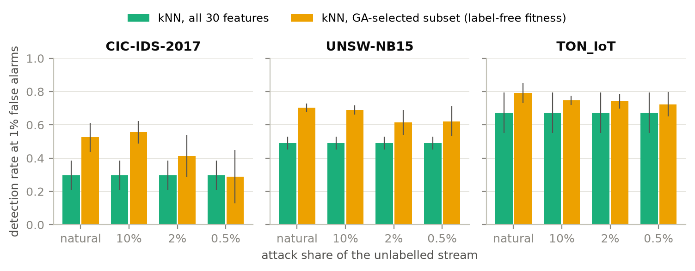{width=95%}

The GA never sees an attack label. Its fitness rewards alarms on the unlabelled stream at low
false-alarm thresholds, and the effect shows exactly there (Figure 7): at the natural attack
share the detection rate at 1% false alarms rises from 0.30 to 0.53 on CIC-IDS-2017, from 0.49
to 0.71 on UNSW-NB15 and from 0.67 to 0.79 on TON_IoT. The selected subsets have 10–13 of the 30
features. Over all 120 runs the GA subset beats all features on this metric in 99 runs and loses
in 21 (mean gain 0.106; Wilcoxon signed-rank p = 2 × 10⁻¹⁴).

The honest qualifications:

- The gain in AUC is small (mean +0.002 over all runs, +0.003 to +0.019 at the natural share).
  The fitness optimises the low-false-alarm region, not the whole ROC curve.
- The gain shrinks as attacks become rare, and at 0.5% on CIC-IDS-2017 it disappears (0.30 vs
  0.29), because the fitness signal $\pi \cdot \mathrm{TPR}$ becomes as small as its sampling
  noise.
- **Inside the fusion the GA adds little.** BRACE and the fusion without selection have the same
  AUC (mean difference −0.001, p = 0.17) and BRACE is ahead by 0.007 in detection at 1% false
  alarms (p = 0.015). The classifier already supplies most of what selection adds to kNN.

**Which features are selected differs by network** (Table 10), which is consistent with
Section 10.2: there is no universal subset, and selection has to happen on the target.

**Table 10. Selection frequency over 10 GA runs per dataset (natural attack share).**

| Feature | CIC-IDS-2017 | UNSW-NB15 | TON_IoT |
|---|---|---|---|
| Service: HTTP | 1.0 | 0.5 | 0.6 |
| Destination bytes | 0.5 | 0.6 | 0.8 |
| Source bytes per packet | 0.3 | 1.0 | 0.6 |
| Bytes per packet | 0.2 | 1.0 | 0.5 |
| Is UDP | 0.1 | 1.0 | 0.1 |
| Is TCP | 0.1 | 0.4 | 1.0 |
| Total packets | 0.8 | 0.2 | 0.3 |
| Destination bytes per second | 0.0 | 0.0 | 0.8 |
| Service: DNS | 0.2 | 0.7 | 0.1 |
| Mean inter-arrival time | 0.4 | 0.0 | 0.0 |

### 10.7 Comparison of optimisers

Nine search methods were run on the same label-free fitness over the 30-feature space with the
same budget of 300 evaluations (3 runs each; greedy forward selection is deterministic).

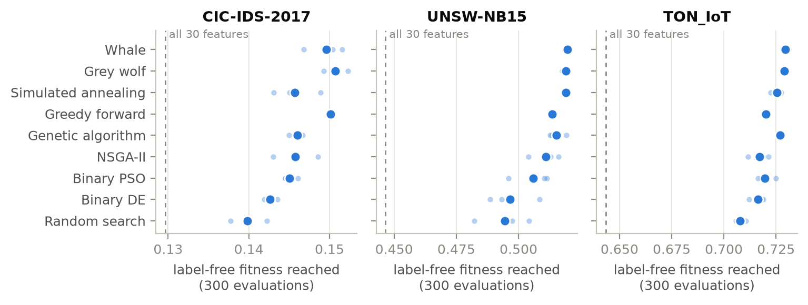{width=95%}

**Table 11. Optimisers on the label-free fitness: fitness reached / test AUC of the selected
subset (labels used only to report the AUC).**

| Optimiser | CIC-IDS-2017 | UNSW-NB15 | TON_IoT |
|---|---|---|---|
| All 30 features (no search) | 0.130 / 0.822 | 0.447 / 0.930 | 0.643 / 0.989 |
| Random search | 0.140 / 0.796 | 0.495 / 0.943 | 0.708 / 0.990 |
| Binary DE | 0.143 / 0.830 | 0.497 / 0.944 | 0.716 / 0.991 |
| Binary PSO (V-shaped) | 0.145 / 0.837 | 0.506 / 0.950 | 0.720 / 0.992 |
| NSGA-II | 0.146 / 0.838 | 0.511 / 0.947 | 0.717 / 0.992 |
| Genetic algorithm | 0.146 / 0.838 | 0.515 / 0.948 | 0.727 / 0.992 |
| Greedy forward selection | 0.150 / 0.850 | 0.514 / 0.949 | 0.720 / 0.992 |
| Simulated annealing | 0.146 / 0.836 | 0.519 / 0.948 | 0.726 / 0.992 |
| Whale optimisation | 0.150 / 0.813 | 0.520 / 0.949 | 0.730 / 0.992 |
| Grey wolf optimiser | 0.151 / 0.845 | 0.519 / 0.949 | 0.729 / 0.992 |

Every optimiser improves on all features and on random search in fitness. Grey wolf and whale
optimisation are first or within 0.001 of first on all three datasets; the GA is mid-table; binary DE is
the weakest metaheuristic. The differences between metaheuristics are small (within 0.01 of
fitness), and simple greedy forward selection is competitive at this budget. Binary PSO needed a
V-shaped transfer function to converge at all; with the classic sigmoid transfer it kept
re-sampling bits at random. Higher fitness does not always mean higher test AUC (whale on
CIC-IDS-2017: best fitness, lower AUC), which is the expected consequence of optimising the
low-false-alarm region. We kept the GA in BRACE because it was fixed before this comparison was
run; replacing it by the grey wolf optimiser is a one-line change.

### 10.8 Which attacks are caught and which are missed

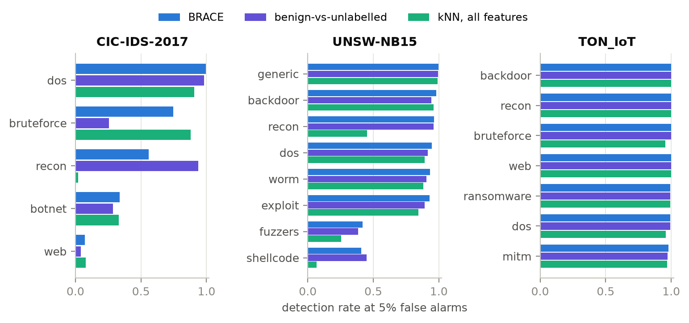{width=95%}

**Table 12. Detection rate at 5% false alarms per attack family.**

| Dataset | Family | kNN | Classifier | BRACE | Supervised on target labels |
|---|---|---|---|---|---|
| CIC-IDS-2017 | DoS / DDoS | 0.91 | 0.98 | 1.00 | 1.00 |
| | Brute force | 0.88 | 0.26 | 0.75 | 1.00 |
| | Port scan (recon) | 0.02 | 0.94 | 0.56 | 1.00 |
| | Botnet | 0.33 | 0.29 | 0.34 | 0.99 |
| | Web attacks | 0.08 | 0.04 | 0.07 | 0.91 |
| UNSW-NB15 | Generic | 0.99 | 0.99 | 1.00 | 1.00 |
| | Backdoor | 0.96 | 0.94 | 0.98 | 0.99 |
| | Reconnaissance | 0.45 | 0.96 | 0.96 | 0.96 |
| | DoS | 0.89 | 0.92 | 0.95 | 0.97 |
| | Worms | 0.88 | 0.91 | 0.93 | 0.95 |
| | Exploits | 0.84 | 0.89 | 0.93 | 0.96 |
| | Fuzzers | 0.25 | 0.38 | 0.42 | 0.53 |
| | Shellcode | 0.07 | 0.45 | 0.41 | 0.62 |
| TON_IoT | all seven families | 0.96–1.00 | 0.97–1.00 | 0.98–1.00 | 0.98–1.00 |

- **The two scores see different attacks.** Port scans in CIC-IDS-2017 are invisible to the
  distance score (0.02): a scan flow is a short flow with no reply, and such flows are common in
  benign traffic. The classifier finds them (0.94) because their *density* in the stream is far
  above the benign density. Brute force is the reverse (0.88 vs 0.26). The fusion recovers most
  of each but, being a compromise, is below the better single score in both cases.
- **Low-volume attacks are missed.** Web attacks (0.07) and botnet traffic (0.34) on
  CIC-IDS-2017 look like ordinary HTTP flows at the level of 30 flow statistics and are rare in
  the stream. A model with labels separates them (0.91, 0.99), so the information is in the
  features but neither a distance to benign flows nor a density excess exposes it. This is the
  main weakness of the method and is stated as such.
- Fuzzers and shellcode on UNSW-NB15 are hard even with labels (0.53, 0.62).

### 10.9 Validation on an unseen dataset and across days

BRACE was designed on the three main datasets. CSE-CIC-IDS2018 (8.3 million flows, different
topology, partly different attacks) was held back until the method was frozen, then run once
with unchanged settings. Separately, we tested what happens when the benign calibration flows
come from a *different day* than the monitored traffic: Monday for CIC-IDS-2017 (the stream is
Tuesday to Friday) and the first capture day for CSE-CIC-IDS2018.

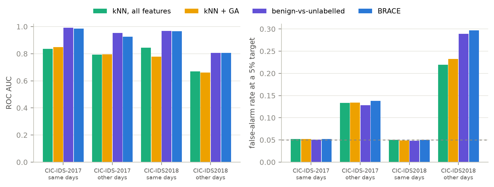{width=98%}

**Table 13. Validation (natural attack share, 6,000 calibration flows). Each cell: ROC AUC /
false-alarm rate obtained at a 1% target.**

| Setting | kNN, all features | Classifier | BRACE | Supervised on target labels (AUC) |
|---|---|---|---|---|
| CIC-IDS-2017, same days | 0.822 / 0.9% | 0.988 / 0.9% | 0.980 / 1.1% | 0.998 |
| CIC-IDS-2017, calibrated on Monday | 0.782 / 6.0% | 0.951 / 8.6% | 0.922 / 8.5% | 0.998 |
| **CSE-CIC-IDS2018, same days (external)** | 0.886 / 1.1% | 0.969 / 0.8% | **0.968 / 1.0%** | 0.981 |
| CSE-CIC-IDS2018, calibrated on day 1 | 0.658 / 7.1% | 0.808 / 23.1% | 0.796 / 20.3% | 0.978 |

**The method transfers to a dataset it was not designed on.** On CSE-CIC-IDS2018 with calibration
and stream from the same period, BRACE reaches 0.968 AUC (0.958 when attacks are 2% of the
stream), within 0.013 of the labelled reference, detects 80% of attacks at 1% false alarms, and
keeps the requested false-alarm rate. One difference from the main datasets: GA selection
lowered the AUC of the kNN score here (0.847 against 0.886) while still doubling its detection
rate at 1% false alarms (0.49 against 0.25).

**Day-to-day drift of benign traffic breaks the calibration.** When the benign sample is from
another day, two things go wrong. The false-alarm rate is no longer the requested one: 6–9%
instead of 1% on CIC-IDS-2017 and 20–23% on CSE-CIC-IDS2018. And ranking quality falls: BRACE
drops from 0.980 to 0.922 and from 0.968 to 0.796. The reason is visible in the classifier: it is
trained to separate "calibration benign" from "the stream", and if benign traffic itself has
changed between the two, it learns that change as well as the attacks. With attacks at 2% of
the stream the drift signal dominates and BRACE falls to 0.73 (CIC-IDS-2017) and 0.63
(CSE-CIC-IDS2018), below plain kNN.

This is the most important limitation of the method. The guarantee of Step 5 holds when benign
calibration traffic and benign monitored traffic are exchangeable, and benchmark days are not.
In practice it means the calibration sample must be recent and must cover the same hours and
services as the monitored traffic, and it must be refreshed. Detecting the drift and
recalibrating automatically [25] is the first item of future work.

### 10.10 Choice of the benign-only detector, feature pool and calibration size

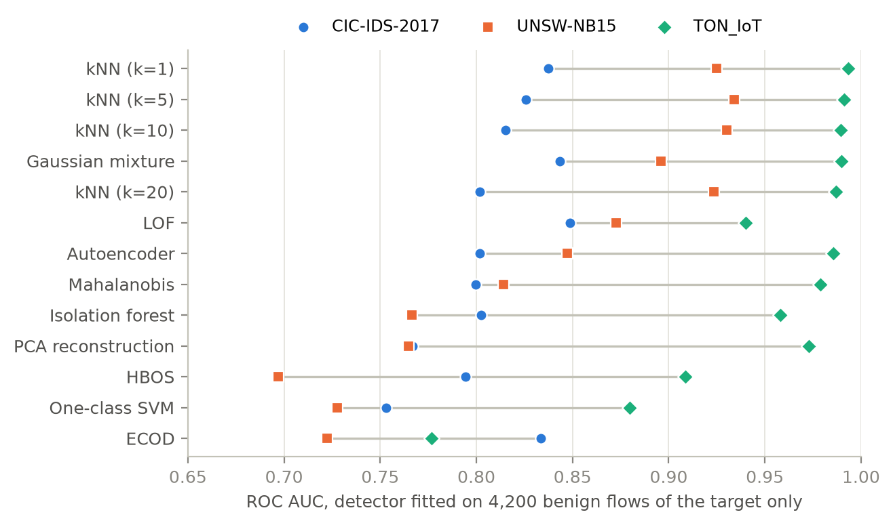{width=75%}

- **Detector.** Nearest-neighbour distance is the best benign-only detector on average
  (k = 1: 0.919, k = 5: 0.917), ahead of a Gaussian mixture (0.910), LOF (0.887), an autoencoder
  (0.878), Mahalanobis distance (0.864), isolation forest (0.842), PCA reconstruction (0.835),
  HBOS (0.800), one-class SVM (0.787) and ECOD (0.778). This is why kNN is the distance score in
  BRACE.
- **Feature pool.** The 30-feature pool is clearly better than the 12 mid-semester features for
  the same detector: 0.826 / 0.934 / 0.991 against 0.754 / 0.902 / 0.950.
- **Representation.** Benign-anchored quantiles and a log-standardised representation perform the
  same for kNN (0.917 each); a robust z-score is slightly worse (0.906).
- **Calibration size.** With 1,000 benign flows the kNN detector reaches 0.790 / 0.905 / 0.983,
  with 10,000 it reaches 0.833 / 0.936 / 0.993. A few thousand benign flows are enough for the
  distance score; the classifier of Step 4 benefits from more (Section 10.5).

### 10.11 Summary of statistical comparisons

**Table 14. Paired comparisons over all 120 runs of Section 10.5 (3 targets × 2 calibration
sizes × 4 attack shares × 5 seeds), Wilcoxon signed-rank test.**

| Comparison | Metric | Mean difference | Wins / losses | Worst case | p |
|---|---|---|---|---|---|
| BRACE vs kNN, all features | AUC | +0.034 | 91 / 29 | −0.071 | 1 × 10⁻⁹ |
| BRACE vs classifier alone | AUC | +0.033 | 77 / 43 | −0.029 | 7 × 10⁻⁸ |
| BRACE vs fusion without GA | AUC | −0.001 | 66 / 54 | −0.057 | 0.17 |
| Classifier alone vs kNN | AUC | +0.001 | 62 / 58 | −0.228 | 0.93 |
| BRACE vs kNN, all features | Detection at 1% FA | +0.202 | 108 / 12 | −0.227 | 6 × 10⁻¹⁹ |
| BRACE vs classifier alone | Detection at 1% FA | +0.058 | 89 / 31 | −0.157 | 2 × 10⁻⁸ |
| BRACE vs fusion without GA | Detection at 1% FA | +0.007 | 65 / 54 | −0.093 | 0.015 |
| kNN + GA vs kNN, all features | Detection at 1% FA | +0.106 | 99 / 21 | −0.180 | 2 × 10⁻¹⁴ |

Across the whole range of conditions the fusion is significantly better than either of its two
parts, and neither part is better than the other on average (p = 0.93): each wins where the
other fails, which is the case for combining them.

## 11. Limitations

1. **Benign drift.** When the calibration sample is from a different day, false alarms rise to
   6–23% at a 1% target and AUC falls by 0.06–0.17 (Section 10.9). The method needs recent,
   representative benign traffic.
2. **A clean benign sample is assumed.** We did not measure what happens when the calibration
   sample itself contains attacks.
3. **The fusion needs attacks in the stream.** With about 150 hidden attacks among 30,000 flows
   it is slightly worse than the benign-only kNN score (Section 10.5).
4. **Low-volume attacks that resemble normal traffic are missed**: web attacks (7% detected at 5%
   false alarms) and botnet traffic (34%) on CIC-IDS-2017 (Section 10.8).
5. **The GA's contribution inside the fused detector is small** (+0.007 detection at 1% false
   alarms). Its clear benefit is for the benign-only kNN score at low false-alarm rates, and
   on CSE-CIC-IDS2018 it lowered that score's AUC.
6. **Scope.** Binary detection only; 30 flow-level features without payload or TCP flags; four
   public testbed datasets, not production traffic. The random-split protocol is optimistic
   about drift, as item 1 shows.
7. **Reduced runs.** The mid-semester re-examination used two seeds for two representations and
   one for the third; the optimiser comparison used three runs and a budget of 300; the detector
   comparison used two seeds. An exhaustive study of the label-free fitness landscape and
   sweeps over the stream size were planned and not run.

## 12. Conclusion and Future Work

**Conclusions.**

1. On CIC-IDS-2017, UNSW-NB15 and TON_IoT, supervised intrusion detectors do not transfer:
   0.995 AUC within a dataset, 0.42–0.49 across datasets, for 13 models and 6 alignment or
   domain-adaptation methods.
2. The cause is structural. Eleven of 30 shared features reverse their relationship with the
   attack label between datasets, benign traffic of different networks does not overlap, and the
   same attack family looks different in each testbed.
3. The feature-selection gain we reported at mid-semester came from choosing the subset on the
   test pairs. Chosen without the target dataset, no subset improves supervised transfer. We
   withdraw the earlier claim.
4. Detection that is *relative to the target's own benign traffic* does work without any attack
   label and without source data. BRACE reaches 0.980 / 0.972 / 0.998 AUC on the three datasets
   and 0.968 on the held-out CSE-CIC-IDS2018, within 0.02 of a supervised model that has the
   target's labels, at a controlled false-alarm rate.
5. Metaheuristic feature selection is possible on an unlabelled network through a fitness that
   needs no attack label. It raises the detection rate of the benign-only detector at 1% false
   alarms by 0.11 on average; all eight optimisers tested beat random search, with small
   differences between them.
6. The method depends on benign calibration traffic that matches the monitored traffic. Under
   day-to-day drift its false-alarm guarantee fails. This is its main open problem.

**Future work.**

- Drift detection and rolling recalibration of the benign sample.
- A statistical test that accepts a selected subset only when its fitness gain exceeds the
  sampling noise, to remove the losses at very low attack shares.
- Robustness to attacks inside the calibration sample.
- Richer features (payload, TCP state) for web and botnet attacks; multi-class attribution.
- The exhaustive fitness-landscape study and larger optimiser comparison.
- Writing the results up as a research paper.

## 13. References

[1] M. Cantone, C. Marrocco, and A. Bria, "Machine learning in network intrusion detection: a
cross-dataset generalization study," *IEEE Access*, vol. 12, pp. 144489–144508, 2024.

[2] M. Z. Hossain, M. A. R. Khan, M. R. Islam, S. M. S. Islam, and T. Gedeon, "Assessing
generalisation capability of machine learning models for intrusion detection," arXiv:2605.04407, 2026.

[3] M. A. Hakim, M. S. Uddin, and T. I. Anis, "Cross-domain generalization failure in
lightweight intrusion detection models for IIoT networks," arXiv:2607.00553, 2026.

[4] M. U. Butt, A. Hotho, and D. Schlör, "Evaluating tabular representation learning for
network intrusion detection," arXiv:2605.02519, 2026.

[5] I. Sharafaldin, A. H. Lashkari, and A. A. Ghorbani, "Toward generating a new intrusion
detection dataset and intrusion traffic characterization," in *Proc. ICISSP*, 2018.

[6] N. Moustafa and J. Slay, "UNSW-NB15: a comprehensive data set for network intrusion
detection systems," in *Proc. MilCIS*, 2015.

[7] N. Moustafa, "A new distributed architecture for evaluating AI-based security systems at
the edge: Network TON_IoT datasets," *Sustainable Cities and Society*, vol. 72, 2021.

[8] Z. Fatima and A. Ali, "Effective metaheuristic based classifiers for multiclass intrusion
detection," arXiv:2210.02678, 2022.

[9] C. Suman, S. Tripathy, and S. Saha, "Building an effective intrusion detection system using
unsupervised feature selection in multi-objective optimization framework," arXiv:1905.06562, 2019.

[10] C. Li, "Multi-population diversity-guided genetic algorithm for feature selection in
network intrusion detection," arXiv:2605.19864, 2026.

[11] A. Mojtahedi, F. Sorouri, A. N. Souha, A. Molazadeh, and S. S. Mehr, "Feature
selection-based intrusion detection system using genetic whale optimization algorithm and
sample-based classification," arXiv:2201.00584, 2022.

[12] L. Yang et al., "A multi-objective AutoML-based efficient intrusion detection system for EV
charging networks," arXiv:2608.02274, 2026.

[13] S. Layeghy, M. Baktashmotlagh, and M. Portmann, "DI-NIDS: Domain invariant network
intrusion detection system," *Knowledge-Based Systems*, 2023 (arXiv:2210.08252).

[14] M. Ring, S. Wunderlich, D. Scheuring, D. Landes, and A. Hotho, "A survey of network-based
intrusion detection data sets," *Computers & Security*, vol. 86, pp. 147–167, 2019.

[15] J. Vitorino, M. Silva, E. Maia, and I. Praça, "An adversarial robustness benchmark for
enterprise network intrusion detection," in *Proc. FPS*, 2023 (arXiv:2402.16912).

[16] A. Virmaux, I. Saffar, J. Zhang, and B. Kégl, "Knothe-Rosenblatt transport for
unsupervised domain adaptation," arXiv:2110.02716, 2021.

[17] G. Blanchard, G. Lee, and C. Scott, "Semi-supervised novelty detection," *Journal of
Machine Learning Research*, vol. 11, pp. 2973–3009, 2010.

[18] C. Elkan and K. Noto, "Learning classifiers from only positive and unlabeled data," in
*Proc. ACM SIGKDD*, 2008.

[19] S. Bates, E. Candès, L. Lei, Y. Romano, and M. Sesia, "Testing for outliers with conformal
p-values," *Annals of Statistics*, vol. 51, no. 1, pp. 149–178, 2023.

[20] A. Marandon, L. Lei, D. Mary, and E. Roquain, "Adaptive novelty detection with false
discovery rate guarantee," *Annals of Statistics*, vol. 52, no. 1, pp. 157–183, 2024.

[21] M. M. R. Siddiquee et al., "AUCp: Pseudo-AUC for inference model selection with unlabeled
validation data in abnormality detection," arXiv:2606.08742, 2026.

[22] P. Golchin, N. Rafiee, M. Hajizadeh, A. Khalil, R. Kundel, and R. Steinmetz, "SSCL-IDS:
Enhancing generalization of intrusion detection with self-supervised contrastive learning," in
*Proc. IFIP Networking*, 2024.

[23] G. Apruzzese, L. Pajola, and M. Conti, "The cross-evaluation of machine learning-based
network intrusion detection systems," arXiv:2203.04686, 2022.

[24] S. Layeghy and M. Portmann, "Explainable cross-domain evaluation of ML-based network
intrusion detection systems," *Computers and Electrical Engineering*, vol. 108, 108692, 2023.

[25] D. Han et al., "Anomaly detection in the open world: normality shift detection,
explanation, and adaptation," in *Proc. NDSS*, 2023.

[26] R. Dilworth and C. Gudla, "Applications of positive unlabeled (PU) and negative unlabeled
(NU) learning in cybersecurity," arXiv:2412.06203, 2024.

[27] Y. Ganin et al., "Domain-adversarial training of neural networks," *Journal of Machine
Learning Research*, vol. 17, no. 59, pp. 1–35, 2016.

[28] B. Sun and K. Saenko, "Deep CORAL: Correlation alignment for deep domain adaptation," in
*Proc. ECCV Workshops*, 2016.

[29] Canadian Institute for Cybersecurity, "CSE-CIC-IDS2018 on AWS," dataset, 2018.

[30] S. Mirjalili and A. Lewis, "S-shaped versus V-shaped transfer functions for binary particle
swarm optimization," *Swarm and Evolutionary Computation*, vol. 9, pp. 1–14, 2013.

[31] G. Ke et al., "LightGBM: A highly efficient gradient boosting decision tree," in *Proc.
NeurIPS*, 2017.

[32] R. A. Fisher, *Statistical Methods for Research Workers*, 4th ed. Edinburgh: Oliver and
Boyd, 1932.

[33] G. Engelen, V. Rimmer, and W. Joosen, "Troubleshooting an intrusion detection dataset: the
CICIDS2017 case study," in *Proc. IEEE Security and Privacy Workshops*, 2021.

[34] D. Arp et al., "Dos and don'ts of machine learning in computer security," in *Proc. USENIX
Security Symposium*, 2022.

```{=typst}
#pagebreak()
```

## Appendix A. Reproducing the Results

```
python -m venv .venv && source .venv/bin/activate
pip install -r requirements.txt

python experiments/01_harmonise.py                 # base tables and the 30-feature pool
python experiments/02_supervised_benchmark.py      # Section 10.1
python experiments/05_shift_diagnosis.py           # Section 10.2
python experiments/08_supervised_fs_revisited.py   # Section 10.3
python experiments/09_final.py --seeds 5           # Sections 10.4 - 10.6, 10.8
python experiments/07_optimisers.py --part B --runs 3 --budget 300 --fitness pu_pauc   # Section 10.7
python experiments/09_final.py --protocol temporal --datasets CIC-IDS-2017 --tag _temporal
python experiments/09_final.py --datasets CSE-CIC-IDS2018 --tag _external
python experiments/03_benign_detectors.py --seeds 2
python experiments/10_figures.py && python experiments/11_tables.py
python tools/build_docs.py reports/09_final_report.md reports/10_final_presentation.md
```

Every number in this report is in `results/v2/TABLES.md`, which is generated from the CSV files
written by the scripts above. Datasets are not stored in the repository; `README.md` lists the
official sources and the expected folder layout.
