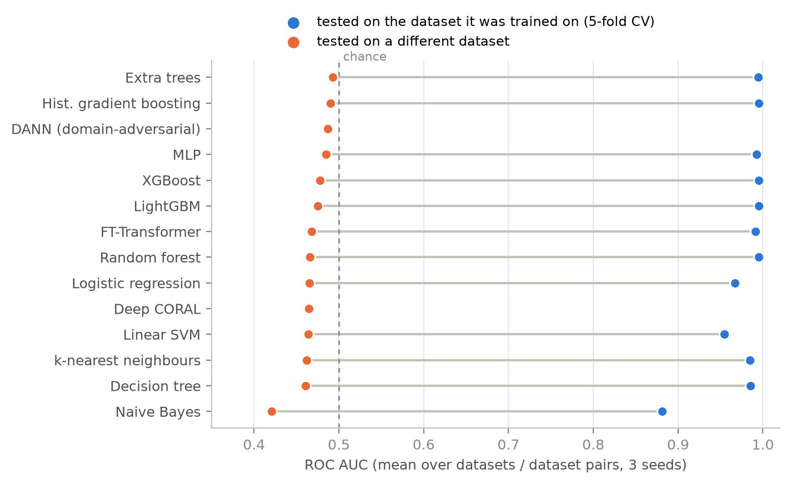
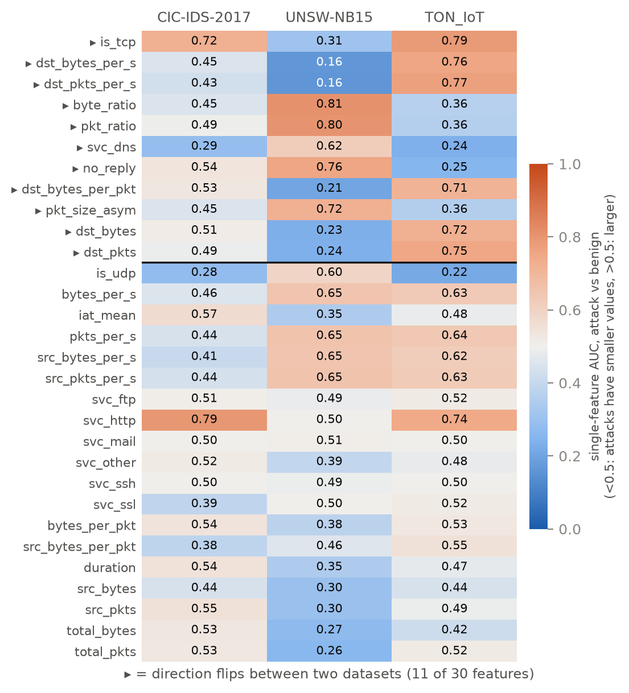
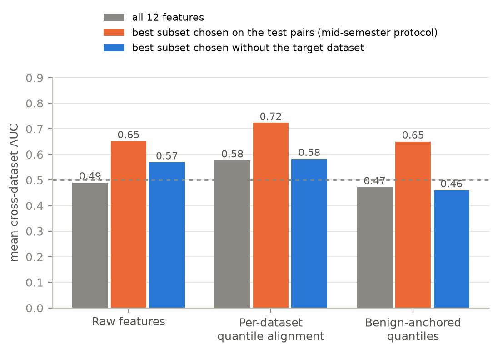
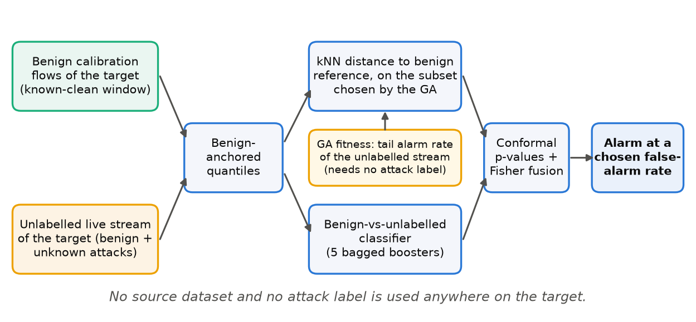
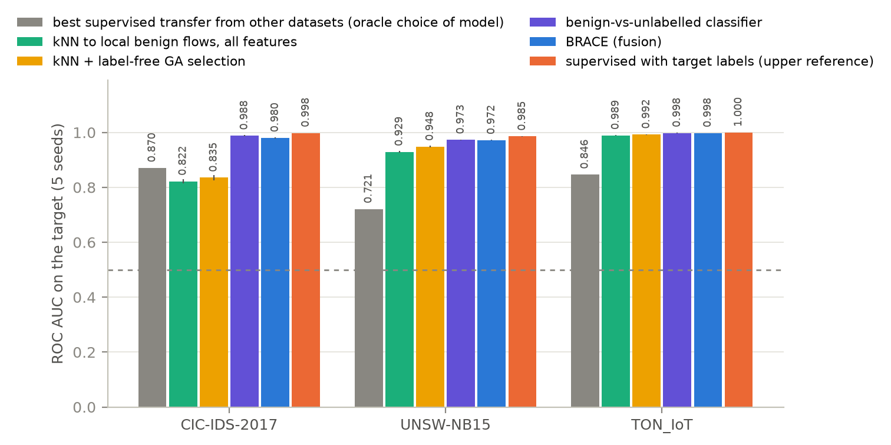
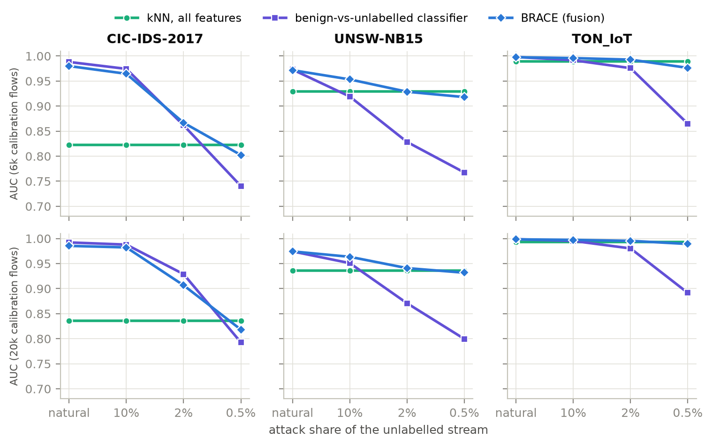
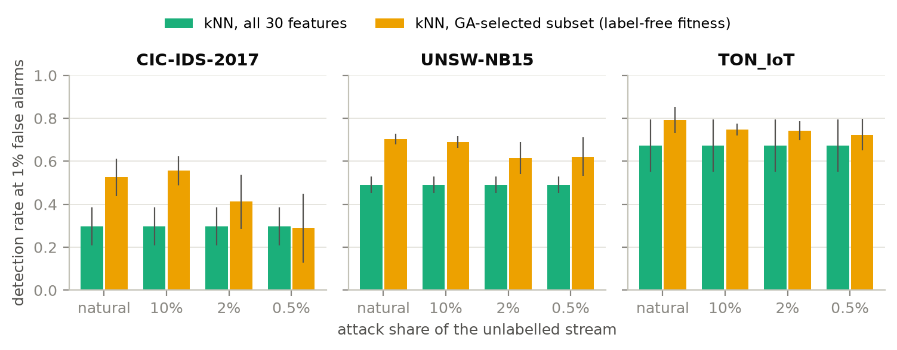
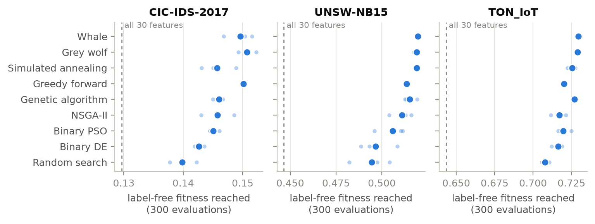
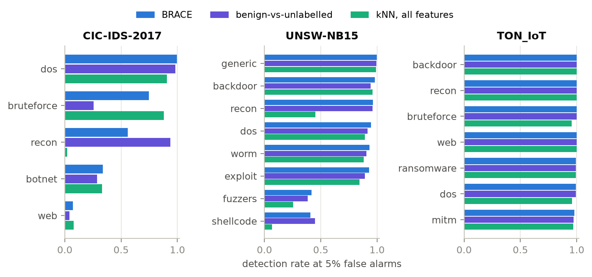
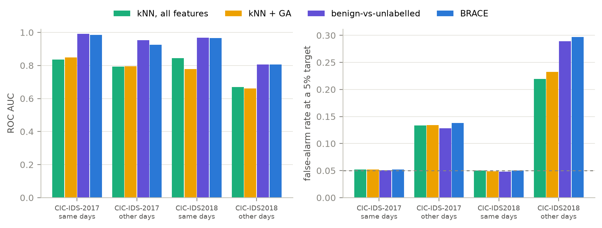

```{=typst}
#set page(paper: "presentation-16-9", margin: 1.1cm)
#set text(size: 14pt)
```

# Index

1. Problem and recap of the mid-semester work
2. What we rebuilt, and an audit of our own result
3. Supervised models do not transfer
4. Why transfer fails
5. The mid-semester feature selection, re-examined
6. Proposed method: BRACE
7. The label-free fitness for metaheuristic selection
8. Results: detection without attack labels
9. Effect of attack rarity
10. What the GA contributes; comparison of optimisers
11. Per-attack behaviour
12. Temporal and external validation
13. Limitations, conclusion, future work

```{=typst}
#pagebreak()
```

# The problem

- ML-based intrusion detectors report **> 99%** when trained and tested on the *same* dataset.
- A deployed detector is trained on one network and must work on **another**.
- We train on one public dataset and test on another: **CIC-IDS-2017, UNSW-NB15, TON_IoT**.
- **Question 1:** how much performance survives, and why does the rest disappear?
- **Question 2:** what can be done, and where does metaheuristic feature selection help?

**Mid-semester status:** five tree models benchmarked; DA-MFS (alignment + GA/PSO selection) proposed.

```{=typst}
#pagebreak()
```

# What changed since mid-semester

We re-read the mid-semester code line by line before extending it.

| Problem found | Correction |
|---|---|
| GA/PSO fitness scored subsets on the **same test pairs** that were reported | Selection never sees the target dataset |
| "Same-dataset" scores were on the **training rows** | Stratified 5-fold cross-validation |
| Only 12 features (4,095 subsets) | 30-feature pool; 12-feature space enumerated exhaustively |
| Accuracy (0.508) was below the majority-class rate | AUC, balanced accuracy, detection at fixed false alarms |
| Payload bytes mixed with header-inclusive bytes | One byte definition for all datasets |

New code base: `src/xids/` (12 modules) and 11 experiment scripts.

```{=typst}
#pagebreak()
```

# Supervised models do not transfer

{width=13.5cm}

13 models, 3 seeds. Same dataset: **0.995** AUC. Different dataset: **0.42–0.49**. The model family makes no difference.

```{=typst}
#pagebreak()
```

# Alignment and domain adaptation do not fix it

| Representation | Logistic reg. | Random forest | LightGBM | MLP |
|---|---|---|---|---|
| Raw | 0.465 | 0.466 | 0.475 | 0.485 |
| Per-dataset standardisation | 0.516 | 0.524 | 0.486 | 0.492 |
| Per-dataset quantile alignment | 0.443 | 0.535 | 0.515 | 0.501 |
| CORAL | 0.476 | 0.532 | 0.516 | 0.484 |
| Benign-anchored quantiles | 0.462 | 0.599 | 0.554 | 0.525 |

- DANN 0.487, Deep CORAL 0.465 (one source → one target, ROC AUC).
- Individual pairs range from 0.906 (CIC-IDS-2017 → TON_IoT) to **0.151** (UNSW-NB15 → TON_IoT).
- An AUC of 0.15 means the model is confidently wrong.

```{=typst}
#pagebreak()
```

# Why transfer fails (1): features change meaning

{height=13.5cm}

```{=typst}
#pagebreak()
```

# Why transfer fails (2)

- **11 of 30 features flip direction** between datasets.
  Response packets: attacks get *fewer* in UNSW-NB15 (0.24), *more* in TON_IoT (0.75).
- **Benign traffic of two networks does not overlap.** A classifier tells datasets apart from
  benign flows alone with AUC 1.000, before and after alignment.
- **The same attack family rarely transfers.**

| Family | Train → test | AUC |
|---|---|---|
| DoS | UNSW-NB15 → TON_IoT | 0.095 |
| DoS | TON_IoT → UNSW-NB15 | 0.204 |
| Brute force | CIC-IDS-2017 → TON_IoT | 0.342 |
| Web | CIC-IDS-2017 ↔ TON_IoT | 0.93–0.95 |

**"What an attack looks like" does not transfer. "What is unusual for this network" can be defined anywhere.**

```{=typst}
#pagebreak()
```

# The mid-semester feature selection, re-examined

{width=11.5cm}

- All 4,095 subsets evaluated exhaustively: exact answers, no optimiser in the loop.
- Subset chosen **on the test pairs**: +0.15 to +0.18 AUC. Chosen **without the target**: no gain.
- **The mid-semester DA-MFS claim is withdrawn.**

```{=typst}
#pagebreak()
```

# Proposed method: BRACE

{width=17cm}

**B**enign-**R**elative **A**nomaly scoring with **C**alibrated **E**volutionary selection.
Inputs on the target: benign calibration flows + the unlabelled live stream. No source data, no attack labels.

```{=typst}
#pagebreak()
```

# A fitness function that needs no attack labels

The unlabelled stream contains an unknown fraction π of attacks. For a feature subset *m*, set
the threshold from held-out benign flows at false-alarm rate α and count alarms on the stream:

**alarm rate(m) = π · TPR(m) + (1 − π) · α**

- π and α do not depend on *m*.
- So **the subset with the most alarms is the subset with the highest true detection rate**.
- A GA (or PSO, DE, GWO, …) can maximise it on the deployment network itself.
- BRACE averages it over α from 0.5% to 5%: the region an operator cares about.

Theory: Blanchard, Lee, Scott, *Semi-supervised novelty detection*, JMLR 2010.

```{=typst}
#pagebreak()
```

# Result: detection without attack labels

{width=15.5cm}

BRACE: **0.980 / 0.972 / 0.998** AUC. Supervised with the target's labels: 0.998 / 0.985 / 1.000. Best supervised transfer: 0.870 / 0.721 / 0.846.

```{=typst}
#pagebreak()
```

# Result table (natural attack share, 5 seeds)

| Method | CIC-IDS-2017 | UNSW-NB15 | TON_IoT | Detection at 1% false alarms |
|---|---|---|---|---|
| Best supervised transfer (oracle) | 0.870 | 0.721 | 0.846 | – |
| kNN to benign, all features | 0.822 | 0.929 | 0.989 | 0.30 / 0.49 / 0.67 |
| kNN + GA selection | 0.835 | 0.948 | 0.992 | 0.53 / 0.71 / 0.79 |
| Benign-vs-unlabelled classifier | 0.988 | 0.973 | 0.998 | 0.82 / 0.77 / 0.98 |
| **BRACE** | **0.980** | **0.972** | **0.998** | **0.80 / 0.78 / 0.96** |
| Supervised on target labels | 0.998 | 0.985 | 1.000 | 0.93 / 0.85 / 1.00 |

- False-alarm control holds: realised 1.1% at a 1% target, 5.1% at a 5% target (120 runs).

```{=typst}
#pagebreak()
```

# When attacks are rare in the stream

{width=15cm}

The classifier alone collapses when attacks are rare; kNN is unaffected; **BRACE follows the better of the two**. At 0.5% (150 hidden attacks) plain kNN is slightly ahead: that is the method's limit.

```{=typst}
#pagebreak()
```

# What the GA contributes

{width=15.5cm}

- Detection at 1% false alarms: **0.30 → 0.53**, **0.49 → 0.71**, **0.67 → 0.79**; 99 wins of 120 runs (p = 2 × 10⁻¹⁴).
- AUC gain is small (+0.003 to +0.019); inside the fusion the GA adds little (+0.007, p = 0.015).

```{=typst}
#pagebreak()
```

# Comparison of optimisers

{width=16cm}

All eight methods beat random search and all features. Grey wolf and whale are best; differences are small; greedy forward selection is competitive.

```{=typst}
#pagebreak()
```

# Which attacks are caught

{width=16cm}

- The two scores see **different attacks**: port scans (kNN 0.02, classifier 0.94), brute force (0.88 vs 0.26).
- **Missed:** web attacks (0.07) and botnet (0.34) on CIC-IDS-2017: low-volume, look like normal HTTP.

```{=typst}
#pagebreak()
```

# Temporal and external validation

{width=15cm}

- **CSE-CIC-IDS2018** (held out until the method was frozen): BRACE **0.968** AUC, labelled reference 0.981, false alarms 1.0% at a 1% target.
- **Calibration from a different day:** AUC falls (0.980 → 0.922; 0.968 → 0.796) and false alarms rise to **6–23%** at a 1% target. Benign drift is the main open problem.

```{=typst}
#pagebreak()
```

# Limitations

- Needs a **clean benign sample** of the target network.
- The fusion needs **enough hidden attacks** in the stream; below about 150 it adds nothing over kNN.
- **Benign drift** between the calibration period and the monitored period inflates false alarms.
- **Low-volume attacks** that resemble normal traffic (web, botnet) are mostly missed.
- Binary detection only; 30 flow-level features; public testbed datasets.
- The GA's contribution inside the fused detector is small.

```{=typst}
#pagebreak()
```

# Conclusion and future work

**Conclusions**

- Supervised NIDS do not transfer across these datasets, whatever the model or alignment.
- The cause is structural: features change meaning between networks.
- Our mid-semester selection result was a selection effect; the corrected result is negative.
- **BRACE** detects attacks on a new network with no attack labels and no source data, within 0.02 AUC of a model that has the labels.
- A **label-free fitness** makes metaheuristic feature selection possible on the deployment network.

**Future work**

- Drift-aware recalibration; a safe-selection test before accepting a subset.
- Payload-level features for web and botnet attacks; multi-class attribution.
- Journal/conference paper from these results.

```{=typst}
#pagebreak()
```

# References (selected)

- [1] Cantone, Marrocco, Bria, IEEE Access 12, 2024. Cross-dataset generalization study.
- [13] Layeghy et al., DI-NIDS, Knowledge-Based Systems, 2023.
- [17] Blanchard, Lee, Scott, Semi-supervised novelty detection, JMLR 11, 2010.
- [19] Bates et al., Testing for outliers with conformal p-values, Ann. Statist. 51, 2023.
- [20] Marandon et al., Adaptive novelty detection with FDR guarantee, Ann. Statist. 52, 2024.
- [22] Golchin et al., SSCL-IDS, IFIP Networking, 2024.
- [23] Apruzzese, Pajola, Conti, Cross-evaluation of ML-based NIDS, 2022.
- [34] Arp et al., Dos and don'ts of machine learning in computer security, USENIX Security, 2022.

Full list of 34 references in the report.

# Thank you

Questions?
